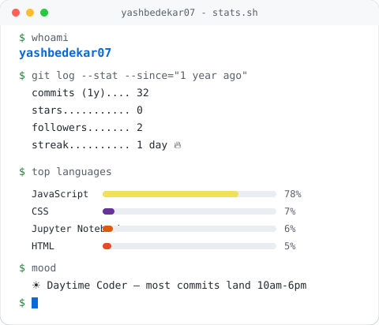

# Hi, I'm Yash 👋

<picture>
  <source media="(prefers-color-scheme: dark)" srcset="./assets/stats-dark.svg">
  <source media="(prefers-color-scheme: light)" srcset="./assets/stats-light.svg">
  
</picture>

*Auto-generated daily by [`scripts/generate_stats.py`](./scripts/generate_stats.py) via [GitHub Actions](./.github/workflows/update.yml) — no manual updates needed.*
